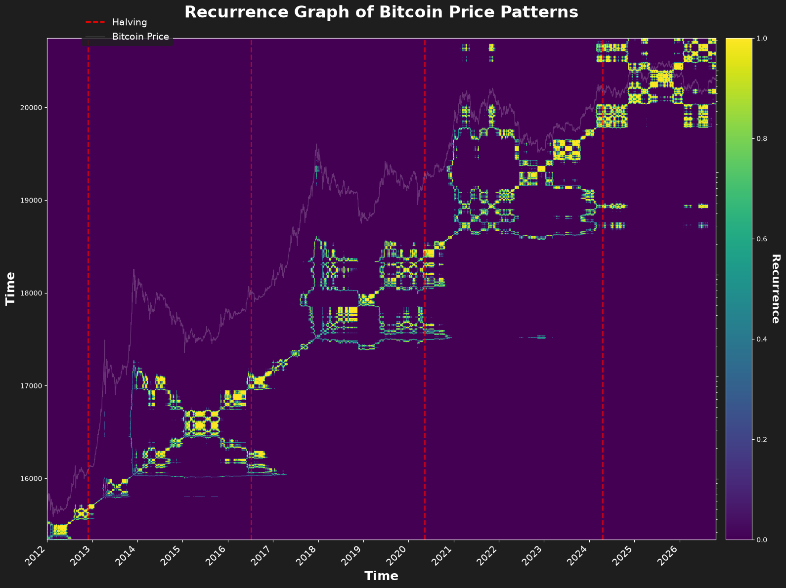

# Assets prices as fractals

Рекуррентный график цены биткоина. Ряд `data/BTC_1d.csv` — дневной Bitstamp, с `2012-01-01`. Ноутбук повторяет ячейку Recurrence Graph of Bitcoin Price Patterns из старого файла и строит её ещё раз на всём ряде.

```bash
pip install -r requirements.txt
jupyter notebook notebooks/bitcoin_recurrence.ipynb
```

Окно поста, `2012-01-01` — `2024-08-26`:


Тот же график до последней свечи:


