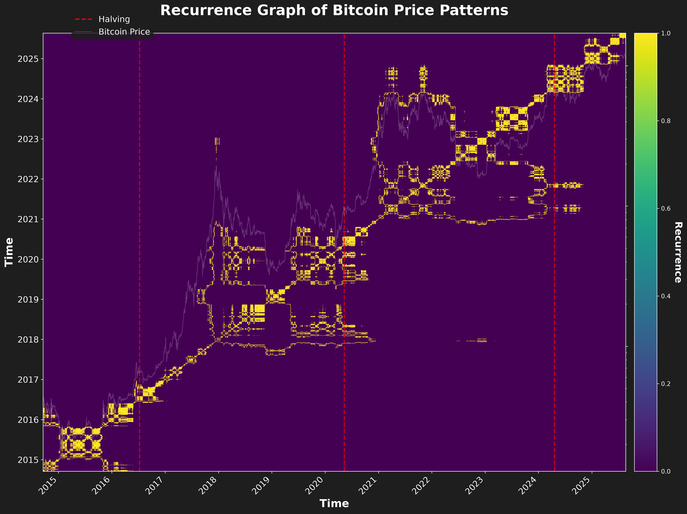

# Assets prices as fractals

Рекуррентный график цены биткоина. Ноутбук собран из старого `Fractal.ipynb`: закачка `BTC-USD` и ячейка с заголовком Recurrence Graph of Bitcoin Price Patterns.

```bash
pip install -r requirements.txt
jupyter notebook notebooks/bitcoin_recurrence.ipynb
```

Run All. Картинка пишется в `output/bitcoin_recurrence_price_plot.png`.


